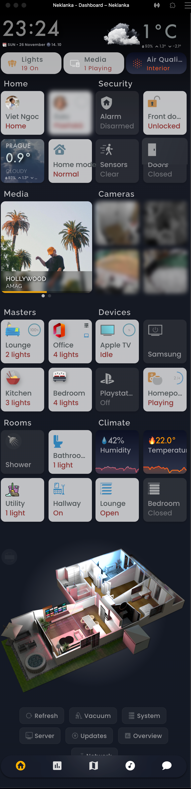
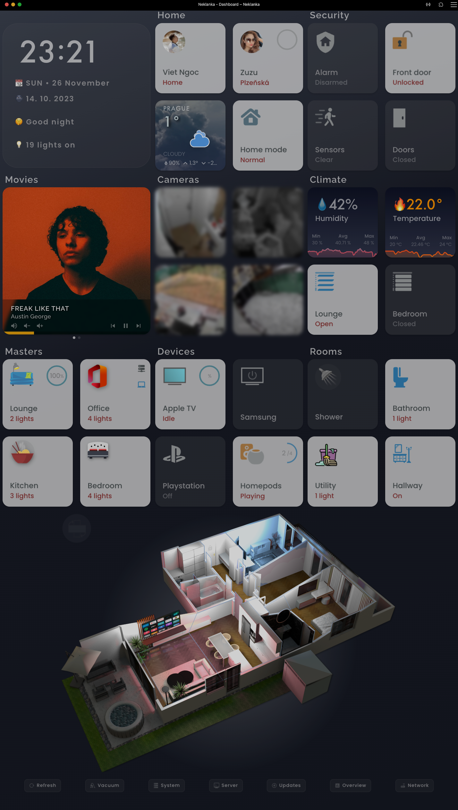
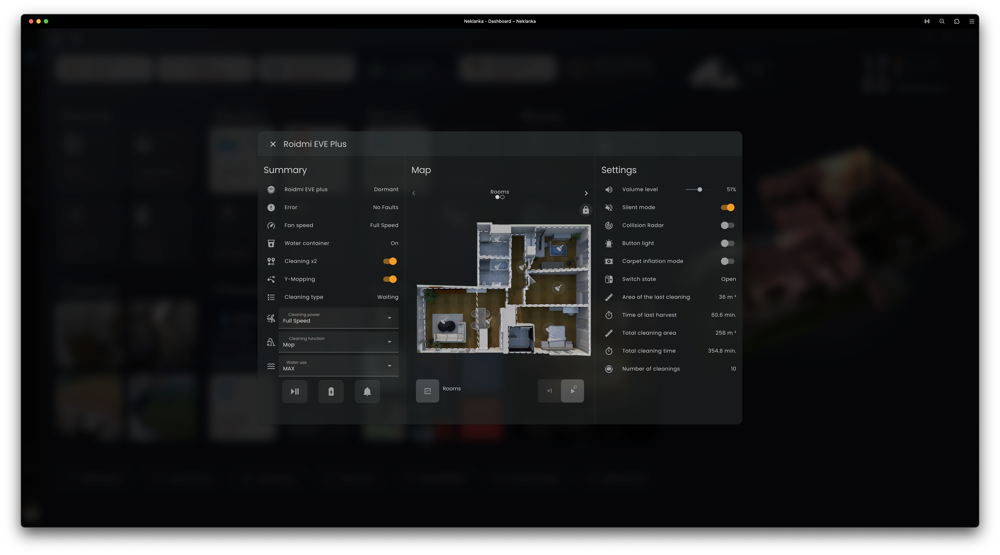
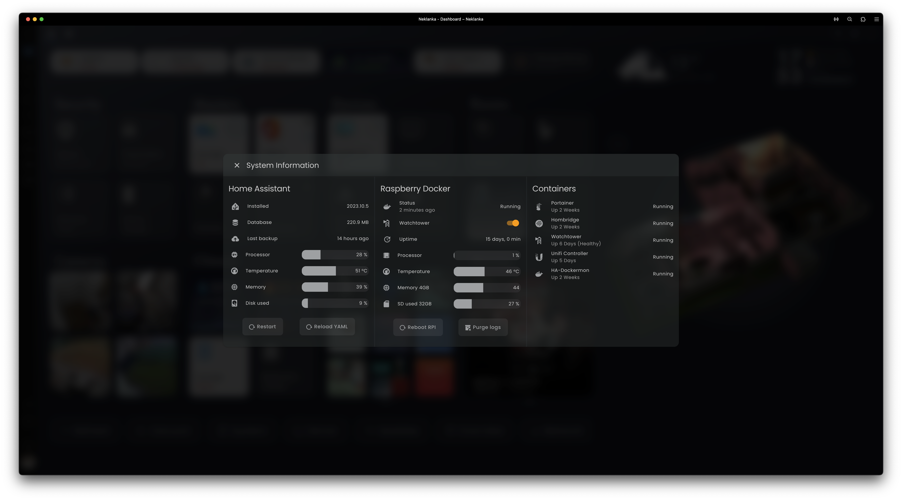
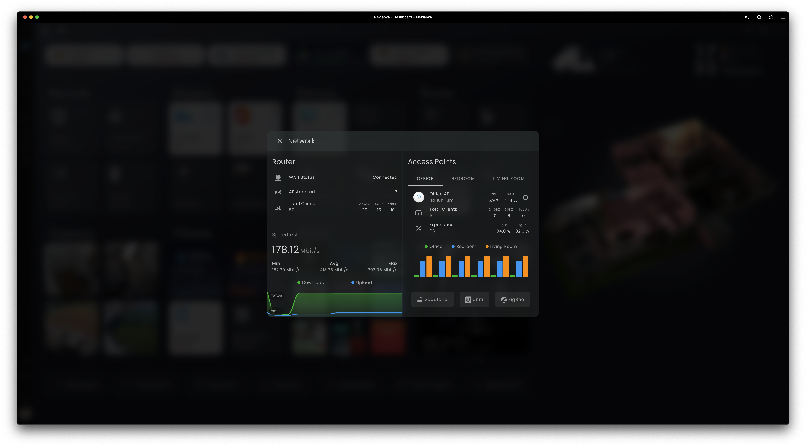
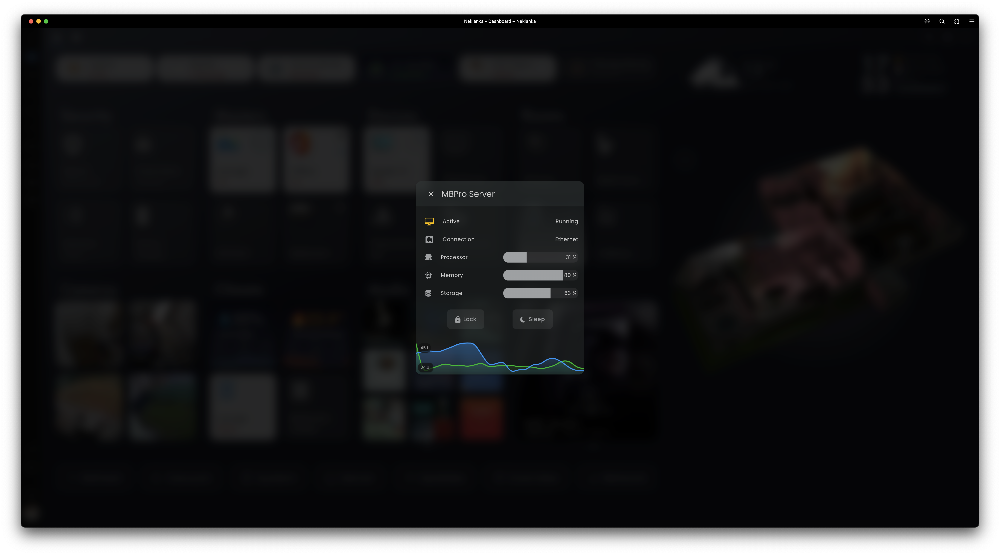
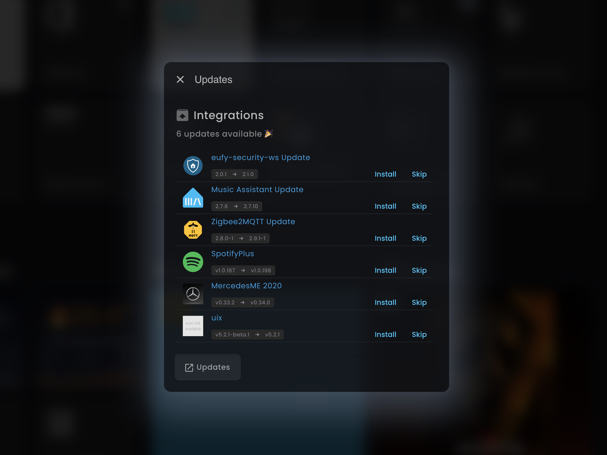

    
    
				

# Home Assistant Configuration

Hey there! Welcome to my little corner of the tech world! 👨‍💻

This is where I store all the cool configurations for my Home Assistant system. Well, it's a mix of awesome codes and setups I discovered from the Home Assistant community. Seriously, those folks are wizards! 🧙‍♂️ As a bit of an internet newbie turned tech enthusiast, I stumbled upon the magic of IT, and this repository is my way of sharing the joy and knowledge I've gained along the way. Dive in, explore, and let the tech magic begin! ✨

I frequently refresh my configuration files. My current Home Assistant version is <b>2026.11.0</b>. If you find something you like, don't forget to give my repository a ⭐️!

## Some of my projects for Home Assistant

<video width="100%" controls loop muted>
  <source src="https://github-production-user-asset-6210df.s3.amazonaws.com/96962827/297112091-acc1a4db-b92e-4ab1-ac9d-df067d4ba4d1.mp4" type="video/mp4">
</video>

https://github.com/ngocjohn/hass-config/assets/96962827/acc1a4db-b92e-4ab1-ac9d-df067d4ba4d1

## Some statistics about my installation

  <table>
      <thead>
          <tr>
              <th>Lines of code</th>
              <th>Automations</th>
              <th>Binary sensors</th>
              <th>Device trackers</th>
              <th>Lights</th>
              <th>Media players</th>
              <th>Sensors</th>
              <th>Switches</th>
              <th>Scripts</th>
          </tr>
      </thead>
      <tbody>
          <tr>
              <td>49,967 </td>
              <td></td>
              <td></td>
              <td></td>
              <td></td>
              <td></td>
              <td></td>
              <td></td>
              <td></td>
          </tr>
      </tbody>
  </table>

## My installed extensions

  
Add-ons

### Add-ons
- Advanced SSH & Web Terminal
- ArgonOne Active Linear Cooling
- Cloudflared
- DbStats
- eufy-sdk bridge
- File editor
- Glances
- Govee to MQTT Bridge
- MariaDB
- Matter Server
- Mosquitto broker
- Music Assistant
- Node-RED
- phpMyAdmin
- Piper
- Provider Watcher
- PS5 MQTT
- Samba share
- Speech-to-Phrase
- Xiaomi Mi Scale
- Zigbee2MQTT

  
Custom integrations

### Custom integrations

  
Lovelace plugins

### Lovelace plugins

## My dashboard

My dashboard is basically a cool fusion of ideas, mainly inspired by the awesome [Matt8707](https://github.com/matt8707/hass-config) 🌟. I threw in some extra goodies to make it perfect for my needs! 🚀

The floorplan is crafted using the [Ha Floorplan](https://github.com/ExperienceLovelace/ha-floorplan) Lovelace plugin, and it features interactive controls thanks to the [Honeycomb Menu](https://github.com/Sian-Lee-SA/honeycomb-menu).

<video width="100%" controls loop muted>
  <source src="https://github-production-user-asset-6210df.s3.amazonaws.com/96962827/286403471-9e4efab5-5bc5-4b71-94d2-37937cf1df77.mp4" type="video/mp4">
</video>

  https://github.com/ngocjohn/hass-config/assets/96962827/77487f2e-3f8e-4362-8767-bc3fd2d08b0a

### Mobile and tablet

<table>
  <tr>
    <td></td>
    <td></td>
  </tr>
</table>

### Popups

<table>
  <tr>
    <td></td>
    <td></td>
  </tr>
  <tr>
    <td></td>
    <td></td>
  </tr>
	<tr>
    <td></td>
    <td></td>
	</tr>
</table>

***

Generated by the [custom readme integration](https://github.com/custom-components/readme)