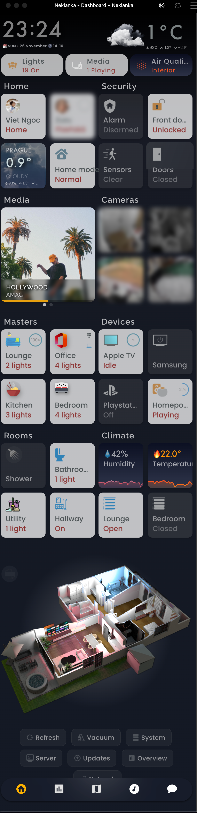
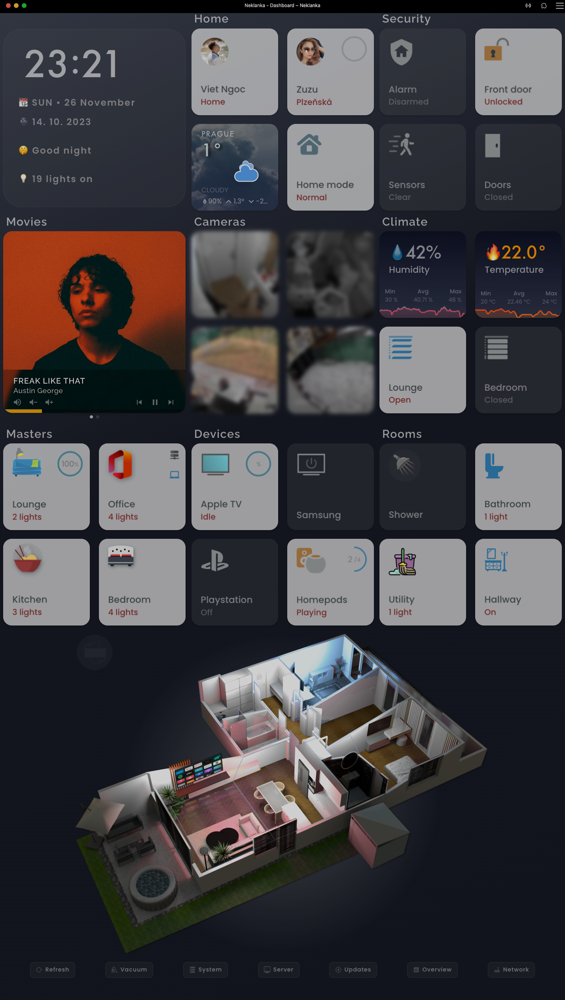
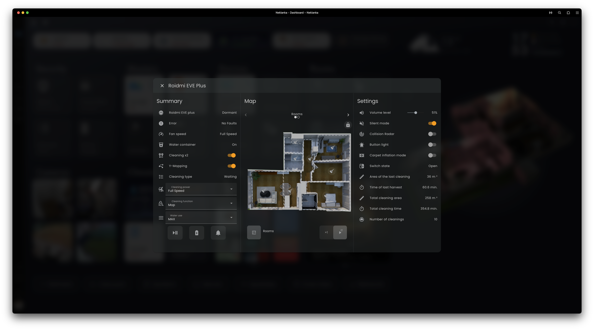
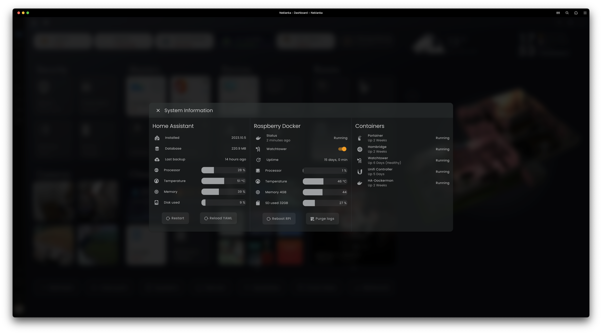
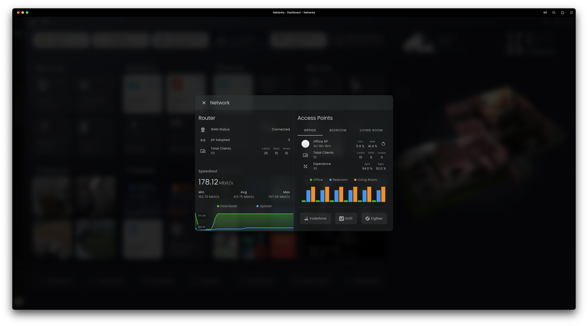
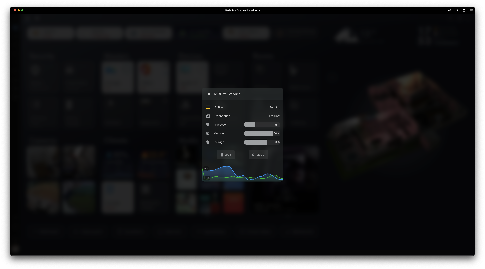
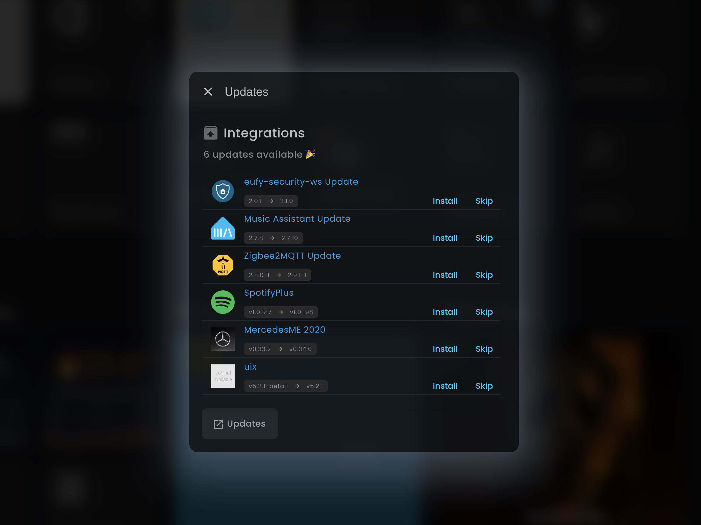

    
    
				

# Home Assistant Configuration

Hey there! Welcome to my little corner of the tech world! 👨‍💻

This is where I store all the cool configurations for my Home Assistant system. Well, it's a mix of awesome codes and setups I discovered from the Home Assistant community. Seriously, those folks are wizards! 🧙‍♂️ As a bit of an internet newbie turned tech enthusiast, I stumbled upon the magic of IT, and this repository is my way of sharing the joy and knowledge I've gained along the way. Dive in, explore, and let the tech magic begin! ✨

I frequently refresh my configuration files. My current Home Assistant version is <b>2026.11.2</b>. If you find something you like, don't forget to give my repository a ⭐️!

## Some of my projects for Home Assistant

<video width="100%" controls loop muted>
  <source src="https://github-production-user-asset-6210df.s3.amazonaws.com/96962827/297112091-acc1a4db-b92e-4ab1-ac9d-df067d4ba4d1.mp4" type="video/mp4">
</video>

https://github.com/ngocjohn/hass-config/assets/96962827/acc1a4db-b92e-4ab1-ac9d-df067d4ba4d1

## Some statistics about my installation

  <table>
      <thead>
          <tr>
              <th>Lines of code</th>
              <th>Automations</th>
              <th>Binary sensors</th>
              <th>Device trackers</th>
              <th>Lights</th>
              <th>Media players</th>
              <th>Sensors</th>
              <th>Switches</th>
              <th>Scripts</th>
          </tr>
      </thead>
      <tbody>
          <tr>
              <td>50,071 </td>
              <td>37</td>
              <td>372</td>
              <td>75</td>
              <td>62</td>
              <td>38</td>
              <td>1810</td>
              <td>303</td>
              <td>28</td>
          </tr>
      </tbody>
  </table>

## My installed extensions

  
Add-ons

### Add-ons
- Advanced SSH & Web Terminal (24.2.1)
- ArgonOne Active Linear Cooling (31a)
- Cloudflared (7.0.21)
- DbStats (0.5.12)
- eufy-sdk bridge (0.8.2)
- File editor (6.3.1)
- Glances (0.23.2)
- Govee to MQTT Bridge (2026.03.25-ab9deb66)
- MariaDB (4.0.0)
- Matter Server (9.3.0)
- Mosquitto broker (7.1.3)
- Music Assistant (2.10.12)
- Node-RED (22.2.2)
- phpMyAdmin (0.14.1)
- Piper (2.5.2)
- Provider Watcher (2.0.0.20261007000345)
- PS5 MQTT (1.9.3)
- Samba share (12.11.0)
- Speech-to-Phrase (1.4.5)
- Xiaomi Mi Scale (0.3.6)
- Z2M Device Tracker (1.5.2)
- Zigbee2MQTT (2.14.3-1)

  
Custom integrations

### Custom integrations
- [Adaptive Lighting](https://github.com/basnijholt/adaptive-lighting) `(v1.32.0)`
- [Baby Tracker](https://github.com/HertBox/ha-baby-tracker) `(v1.0.0)`
- [Better Thermostat](https://github.com/KartoffelToby/better_thermostat) `(2.0.0)`
- [Bravia Rest Api](https://github.com/cmos486/Bravia-REST-API) `(v1.8.0)`
- [Browser Mod](https://github.com/thomasloven/hass-browser_mod) `(v3.4.2)`
- [Custom Icons](https://github.com/thomasloven/hass-custom_icons) `(v1.0.2)`
- [Dyson](https://github.com/cmgrayb/hass-dyson) `(v0.39.0)`
- [Electrolux](https://github.com/TTLucian/ha-electrolux) `(v3.8.5)`
- [Eufy Sdk](https://github.com/mega-yfue/ha-eufy-sdk) `(0.6.0)`
- [Extended Openai Conversation](https://github.com/jekalmin/extended_openai_conversation) `(2.0.3)`
- [Fontawesome](https://github.com/thomasloven/hass-fontawesome) `(v.2.3.0)`
- [Generate Readme](https://github.com/custom-components/readme) `(0.6.0b1)`
- [Google Cloud Speech To Text](https://github.com/chatziko/ha-google-cloud-stt) `(v0.3.1)`
- [Google Home Exposure Manager](https://github.com/NathanMagnus/GoogleHomeExposureManager) `(v0.3.0b1)`
- [Govee](https://github.com/LaggAt/hacs-govee) `(2025.7.1)`
- [Hass Favicon](https://github.com/thomasloven/hass-favicon) `(10.4)`
- [Home Connect Direct](https://github.com/Asmir1975/homeconnect_direct) `(1.13.1)`
- [Home Intercom](https://github.com/mdj2812/home-intercom) `(v2.2.1)`
- [Home Weather](https://github.com/zodyking/home-weather) `(v1.0.67)`
- [Ingress](https://github.com/lovelylain/hass_ingress) `(1.4.0)`
- [Lunar Phase](https://github.com/ngocjohn/lunar-phase) `(v0.3.0)`
- [Mercedesme 2020](https://github.com/ReneNulschDE/mbapi2020) `(v0.44.0)`
- [Node Red Companion](https://github.com/zachowj/hass-node-red) `(v4.3.3)`
- [Ookla Speedtest](https://github.com/soulripper13/hass-speedtest-ookla) `(v3.1.6)`
- [Philips Airpurifier (With Coap)](https://github.com/kongo09/philips-airpurifier-coap) `(v0.37)`
- [Plex Recently Added](https://github.com/custom-components/sensor.plex_recently_added) `(0.6.2)`
- [Remote Home Assistant](https://github.com/custom-components/remote_homeassistant) `(4.6)`
- [Rohlík.Cz Custom Integration](https://github.com/dvejsada/HA-RohlikCZ) `(v1.0.1)`
- [Samsungtv Smart](https://github.com/ollo69/ha-samsungtv-smart) `(v0.14.5)`
- [Samsungtv Tizen](https://github.com/jaruba/ha-samsungtv-tizen) `(v1.6.1)`
- [Simpleicons](https://github.com/vigonotion/hass-simpleicons) `(v2.4.1)`
- [Spook 👻 Your Homie](https://github.com/frenck/spook) `(v5.11.1)`
- [Spotifyplus](https://github.com/thlucas1/homeassistantcomponent_spotifyplus) `(v1.0.224)`
- [Uix](https://github.com/Lint-Free-Technology/uix) `(v9.0.0)`
- [Weather.Com](https://github.com/jaydeethree/Home-Assistant-weatherdotcom) `(2.0.1)`
- [Webrtc Camera](https://github.com/AlexxIT/WebRTC) `(v3.6.1)`
- [Xiaomi Cloud Map Extractor](https://github.com/PiotrMachowski/Home-Assistant-custom-components-Xiaomi-Cloud-Map-Extractor) `(v3.0.0-alpha-21)`
- [Xiaomi Miot](https://github.com/al-one/hass-xiaomi-miot) `(v1.1.6)`
- [Z2M Device Tracker](https://github.com/tempus2016/z2m-device-tracker) `(v1.5.2)`

  
Lovelace plugins

### Lovelace plugins
- [Advanced Camera Card](https://github.com/dermotduffy/advanced-camera-card) `(v8.2.0)`
- [Air Quality Card](https://github.com/firstof9/ha-air-quality-card) `(0.5.1)`
- [Apexcharts Card](https://github.com/RomRider/apexcharts-card) `(v2.2.3)`
- [Apple Tv Remote Control](https://github.com/madmicio/Apple-Tv-Card) `(1.02)`
- [Atomic Calendar Revive](https://github.com/totaldebug/atomic-calendar-revive) `(v10.3.1)`
- [Auto Entities](https://github.com/Lint-Free-Technology/lovelace-auto-entities) `(v2.8.4)`
- [Bar Card](https://github.com/spacerokk/bar-card) `(v4.0.8)`
- [Button Card](https://github.com/custom-cards/button-card) `(v7.1.0-dev.2)`
- [Clock Weather Card](https://github.com/pkissling/clock-weather-card) `(v3.1.0)`
- [Custom Features For Home Assistant Cards](https://github.com/Nerwyn/custom-card-features) `(4.11.3)`
- [Custom Icons](https://github.com/Mariusthvdb/custom-icons) `(v0.3.7)`
- [Dashboard Hotkeys](https://github.com/t0m1o1/HA-hotkeys) `(None)`
- [Decluttering Card](https://github.com/custom-cards/decluttering-card) `(v1.0.0)`
- [Dual Axis Controller](https://github.com/mbb365/Dual-Axis-Controller-v4) `(v9.0.5)`
- [Flex Table   Highly Customizable, Data Visualization](https://github.com/custom-cards/flex-table-card) `(v1.4)`
- [Fold Entity Row](https://github.com/thomasloven/lovelace-fold-entity-row) `(v.2.3.2)`
- [Geo Clock Card](https://github.com/jpettitt/geo-clock-card) `(v0.2.11)`
- [Ha Floorplan 🖌🎨 | Your Imagination (Almost) Defines The Limits](https://github.com/ExperienceLovelace/ha-floorplan) `(v1.1.5)`
- [History Explorer Card](https://github.com/SpangleLabs/history-explorer-card) `(v1.0.54)`
- [Honeycomb Menu](https://github.com/Sian-Lee-SA/honeycomb-menu) `(0.14.8)`
- [Horizon Card](https://github.com/rejuvenate/lovelace-horizon-card) `(v1.5.3)`
- [Hui Element](https://github.com/thomasloven/lovelace-hui-element) `(None)`
- [Ingress Webpage Card](https://github.com/lovelylain/ha-addon-iframe-card) `(1.0.4)`
- [Kiosk Mode](https://github.com/NemesisRE/kiosk-mode) `(v16.0.0)`
- [Layout Card](https://github.com/thomasloven/lovelace-layout-card) `(v2.4.7)`
- [Local Conditional Card](https://github.com/PiotrMachowski/Home-Assistant-Lovelace-Local-Conditional-card) `(v2.1.4)`
- [Logbook Card](https://github.com/royto/logbook-card) `(2.5.6)`
- [Lovelace Touchpad Card](https://github.com/michalowskil/lovelace-touchpad-card) `(v0.17.1)`
- [Lunar Phase Card](https://github.com/ngocjohn/lunar-phase-card) `(v1.19.1)`
- [M3 Cards](https://github.com/j0sp0r/m3-cards) `(v2.8.1)`
- [Mass Search Card](https://github.com/fastxl2024/mass-search-card) `(v0.7.3)`
- [Maxi Media Player](https://github.com/punxaphil/maxi-media-player) `(v10.9.1)`
- [Mediocre Hass Media Player Cards](https://github.com/antontanderup/mediocre-hass-media-player-cards) `(v0.30.0)`
- [Mini Graph Card](https://github.com/kalkih/mini-graph-card) `(v0.13.0)`
- [Mini Media Player](https://github.com/kalkih/mini-media-player) `(v1.16.12)`
- [Modern Circular Gauge](https://github.com/selvalt7/modern-circular-gauge) `(v0.15.0)`
- [More Info Custom](https://github.com/ngocjohn/more-info-custom) `(v1.0.0)`
- [Multiple Entity Row](https://github.com/benct/lovelace-multiple-entity-row) `(v4.13.1)`
- [Mushroom](https://github.com/piitaya/lovelace-mushroom) `(v5.3.0)`
- [Polr Ytube Media Card](https://github.com/pathofleastresistor/polr-ytube-media-card) `(1.7.0)`
- [Purifier Card](https://github.com/gorischek/purifier-card) `(v2026.10.6)`
- [Room Climate Card](https://github.com/hyperfelixations/room-climate-card) `(v2.39.0)`
- [Roscard](https://github.com/yyqclhy/RosCard) `(1.4.2)`
- [Rpi Monitor Card](https://github.com/ironsheep/lovelace-rpi-monitor-card) `(v1.4.2)`
- [Sidebar Organizer](https://github.com/ngocjohn/sidebar-organizer) `(v4.2.2)`
- [Slider Button Card](https://github.com/custom-cards/slider-button-card) `(v1.13.0)`
- [Stack In Card](https://github.com/custom-cards/stack-in-card) `(0.2.0)`
- [State Switch](https://github.com/thomasloven/lovelace-state-switch) `(1.9.6)`
- [Streamline Card](https://github.com/brunosabot/streamline-card) `(v0.2.2)`
- [Swipe Card](https://github.com/bramkragten/swipe-card) `(v5.0.0)`
- [Timer Bar Card](https://github.com/rianadon/timer-bar-card) `(v1.31.1)`
- [Track History Card](https://github.com/sergon2000/lovelace-track-history-card) `(v1.6.0)`
- [Tv Remote Card (With Touchpad And Haptic Feedback)](https://github.com/usernein/tv-card) `(v0.5.2)`
- [Upcoming Media Card](https://github.com/xZetsubou/upcoming-media-card) `(None)`
- [Vehicle Info Card](https://github.com/ngocjohn/vehicle-info-card) `(v1.12.3)`
- [Vehicle Status Card](https://github.com/ngocjohn/vehicle-status-card) `(v1.26.1)`
- [Weather Card](https://github.com/bramkragten/weather-card) `(v1.5.0)`
- [Weather Chart Card](https://github.com/mlamberts78/weather-chart-card) `(V2.4.11)`
- [Weather Forecast Card](https://github.com/troinine/ha-weather-forecast-card) `(v1.1.0)`
- [Weather Radar Card](https://github.com/jpettitt/weather-radar-card) `(v4.0.0)`
- [What Happened Card](https://github.com/jan-tdy/ha-what-happened-card) `(v0.10.1)`
- [Xiaomi Vacuum Map Card](https://github.com/PiotrMachowski/lovelace-xiaomi-vacuum-map-card) `(v2.4.1)`

## My dashboard

My dashboard is basically a cool fusion of ideas, mainly inspired by the awesome [Matt8707](https://github.com/matt8707/hass-config) 🌟. I threw in some extra goodies to make it perfect for my needs! 🚀

The floorplan is crafted using the [Ha Floorplan](https://github.com/ExperienceLovelace/ha-floorplan) Lovelace plugin, and it features interactive controls thanks to the [Honeycomb Menu](https://github.com/Sian-Lee-SA/honeycomb-menu).

<video width="100%" controls loop muted>
  <source src="https://github-production-user-asset-6210df.s3.amazonaws.com/96962827/286403471-9e4efab5-5bc5-4b71-94d2-37937cf1df77.mp4" type="video/mp4">
</video>

  https://github.com/ngocjohn/hass-config/assets/96962827/77487f2e-3f8e-4362-8767-bc3fd2d08b0a

### Mobile and tablet

<table>
  <tr>
    <td></td>
    <td></td>
  </tr>
</table>

### Popups

<table>
  <tr>
    <td></td>
    <td></td>
  </tr>
  <tr>
    <td></td>
    <td></td>
  </tr>
	<tr>
    <td></td>
    <td></td>
	</tr>
</table>

***

Generated by the [custom readme integration](https://github.com/custom-components/readme)